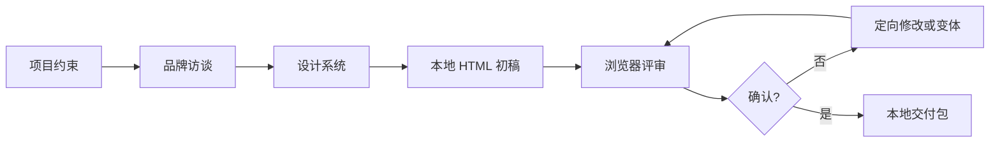

# Howto Design Landingpage

一个面向前端产品、硬件产品和营销项目的 Codex Skill。它把“项目访谈 → 设计系统 → 本地 HTML 实现 → 视觉评审 → 本地交付”整理成可复用工作流。

> 核心目标不是让 AI 每次猜一个页面，而是先确定产品、用户、行动和视觉方向，再用可检查的 HTML/CSS 实现出来。

## 它能做什么

- 通过不超过 10 个问题完成项目与品牌访谈
- 将品牌形容词转化为颜色、字体、形状、密度和图像策略
- 根据产品和转化路径选择页面模块
- 直接生成响应式本地 HTML/CSS
- 支持版本化视觉评审和反馈修改
- 支持邮件订阅、Cookie 偏好和 UTM 透传等常见模块
- 在交付前检查结构、可访问性、图片和占位内容

## 明确不做什么

- 不调用 Stitch、Figma、Pixso、MasterGo 等第三方设计平台 API
- 不执行部署、发布、上传、域名或托管配置
- 不适用于后台、仪表盘、多页应用或组件级任务
- 不编造奖项、认证、评价、指标或法律文案
- 不把未接通的表单伪装成可用的生产系统

## 工作流



### Phase 0：项目约束

确认输出目录、市场语言、用户、主 CTA、素材、邮件/Cookie 需求和交付边界。

### Phase 1：品牌访谈

最多 10 个问题，分三组：

1. 产品、用户和 CTA
2. 品牌形容词和明暗方向
3. 颜色、字体和形状

### Phase 2：设计系统

输出 `DESIGN.md` 和 `color-tokens.json`，把抽象感受转化为可执行的设计规则。

### Phase 3：本地 HTML 迭代

使用本地 HTML/CSS 实现页面，保存版本、在浏览器中评审，并把用户反馈翻译为设计意图。

### Phase 4：本地交付

输出 HTML、设计系统、资产和 Review 说明。只列出待完成项，不提供部署步骤。

## 安装

```bash
cp -R howto-design-landingpage "${CODEX_HOME:-$HOME/.codex}/skills/howto-design-landingpage"
```

调用：

```text
使用 $howto-design-landingpage 为一款新的 AI 硬件产品设计落地页。
```

## 输出结构

```text
project-name/
  index.html
  assets/
  design/
    DESIGN.md
    color-tokens.json
  REVIEW.md
  .howto-design-landingpage/
    metadata.json
    versions/
```

## 仓库结构

```text
howto-design-landingpage/
  SKILL.md
  README.md
  NOTICE.md
  LICENSE
  .gitignore
  agents/
    openai.yaml
  references/
    interview-framework.md
    visual-direction.md
    local-html-workflow.md
    state-and-pitfalls.md
    html-quality-checklist.md
  assets/
    landing-page-starter.html
    readme-cover.svg
  scripts/
    validate-html.mjs
```

## 设计原则

- 先访谈，再实现
- 先设计系统，再写页面
- 页面必须先在浏览器中被看见，再被判断
- 产品事实、素材权利和未完成集成必须保持透明
- 具体模块可以变化，但质量纪律不能遗漏

## HTML 校验

```bash
node scripts/validate-html.mjs path/to/index.html
```

校验器不依赖第三方包，检查文档结构、占位符、图片 alt、外链安全属性、响应式和基础可访问性信号。

## 来源与许可

本仓库是 MIT 许可的独立 Skill 改编版。完整来源和修改说明见 [`NOTICE.md`](NOTICE.md)，代码与文档使用 [`LICENSE`](LICENSE)。
